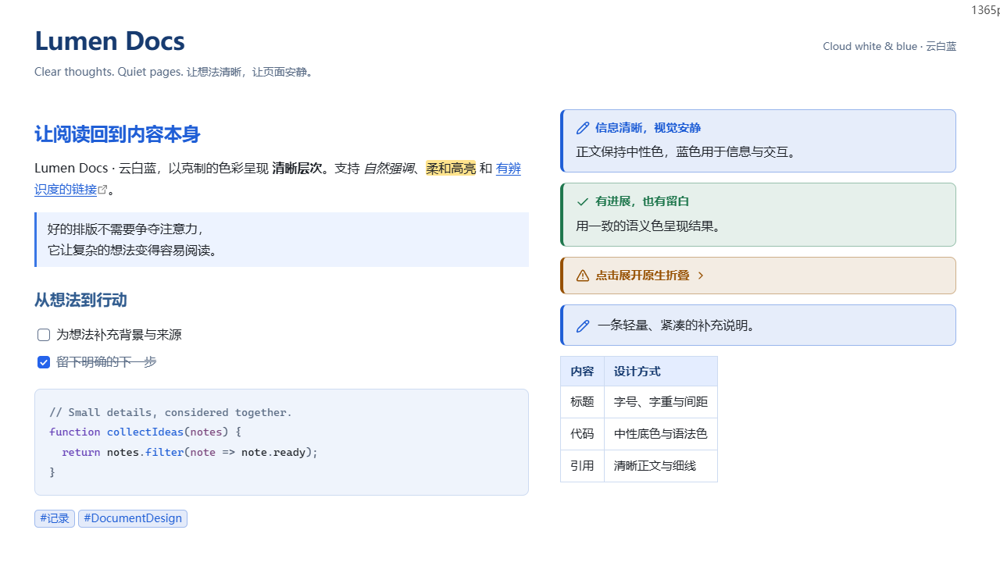
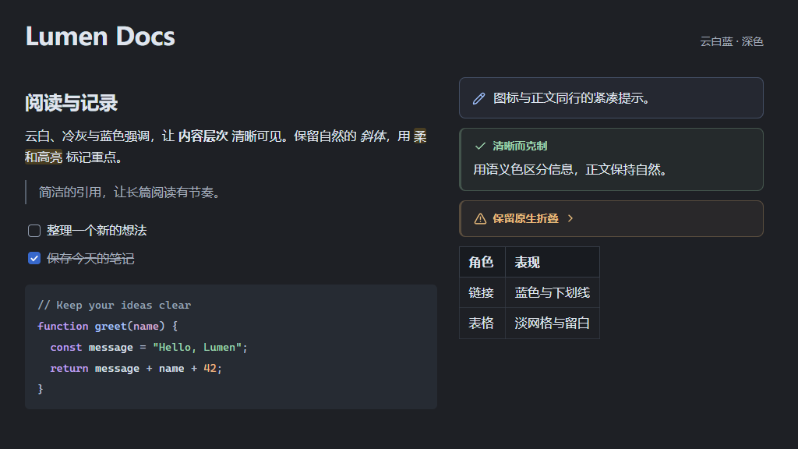

# Lumen Docs

[English](README.md) · [简体中文](README.zh-CN.md)

Lumen Docs is a lightweight Obsidian theme for clear, comfortable document reading. Cloud-white surfaces, cool neutrals, and blue accents give headings, quotes, code, and callouts a quiet visual hierarchy.

The theme supports light and dark appearances in Live Preview and Reading view. It uses native Obsidian CSS variables and needs no additional plugins, downloaded fonts, or network services.

Current public version: **0.1.0**. Requires **Obsidian 1.13.0 or later**.

## Preview

### Light



### Dark



## Installation

### Manual installation

1. Download **`theme.css` and `manifest.json`** from the latest GitHub Release. The source archive is optional; the two files are sufficient to install the theme.
2. Create `.obsidian/themes/Lumen Docs/` inside your vault and copy both files there. If your vault uses a custom configuration folder, use that folder instead of `.obsidian`.
3. Open **Settings → Appearance → Themes** and select **Lumen Docs**. Reopen Settings or restart Obsidian if the theme does not appear immediately.
4. Choose light, dark, or your preferred system appearance.

```text
Your vault/
└─ .obsidian/
   └─ themes/
      └─ Lumen Docs/
         ├─ manifest.json
         └─ theme.css
```

Installation does not require Node.js or community plugins. To update, replace both files. Switching to another theme restores its appearance without modifying your Markdown notes.

## Design

- **Content first:** headings use size, weight, and spacing rather than a rainbow of text colors or decorative rules.
- **Comfortable layout:** the default readable width is 800px and line height is 1.7. Font family and text size follow your Obsidian settings.
- **Purposeful accents:** blue identifies links, checked tasks, and interactive states; soft yellow marks highlighted text.
- **Quiet structure:** neutral quote rules, subtle table grids, and restrained sidebar surfaces separate content without overpowering it.
- **Readable code:** keywords, functions, strings, values, and comments have distinct roles on a neutral background.
- **Native behavior:** task controls, links, callout folding, custom titles, and nested callouts retain their Obsidian behavior.

Completed tasks remain readable in gray. Selected text uses a clear foreground over a blue selection background.

## Callouts

Callouts use a softly tinted background and semantic title/icon colors while keeping their body text neutral. Built-in aliases follow their native type color. Custom callout types can keep their own `--callout-color` and `--callout-icon` settings.

For a compact note with its icon and content on the same row:

```markdown
> [!note|compact]
> A short note without a visible title.
```

Compact styling applies only to non-collapsible `note` callouts and visually hides their title. Use `[!note] Your title` for a visible title. Adding the native `+` or `-` folding marker keeps the title and folding control visible.

## Color palette

### Cloud white and blue

| Role | Light | Dark |
| --- | --- | --- |
| Document background | `#FFFFFF` | `#1E2025` |
| Sidebar background | `#F5F7FA` | `#181B20` |
| Body text | `#1F2329` | `#DFE4ED` |
| Secondary text | `#646A73` | `#A3ACBB` |
| Links and text accents | `#245BDB` | `#82AAFF` |
| Primary button fill | `#2B63E5` | `#3768CC` |
| Text highlight background | `#FFF0B3` | `#493E22` |

Text accents and button fills are defined separately. Dark appearance uses brighter links while retaining a blue button fill suited to white labels.

### Semantic callout colors

| Role | Common types | Light | Dark |
| --- | --- | --- | --- |
| Information | `note`, `info`, `todo`, `summary` | `#245BA9` | `#9BBCF8` |
| Tip | `tip`, `hint` | `#1B7465` | `#7ECCBB` |
| Success | `success`, `check`, `done` | `#2D7549` | `#9CD2AC` |
| Warning | `warning`, `question` | `#94550C` | `#E9BB7B` |
| Danger | `danger`, `error`, `failure`, `bug` | `#B13F45` | `#F19EA4` |
| Example | `important`, `example` | `#7350AD` | `#C2A8F0` |
| Quote | `quote`, `cite` | `#5E646E` | `#AFBAC9` |

### Syntax colors

| Syntax role | Light | Dark |
| --- | --- | --- |
| Keywords | `#6742B8` | `#C2A4F4` |
| Functions | `#245BDB` | `#A8C5FF` |
| Strings | `#236D4B` | `#9FD6B0` |
| Values and important tokens | `#9A4B15` | `#EFBA86` |
| Comments | `#68717E` | `#9AA6B8` |
| Operators and punctuation | `#536075` | `#B3BFD1` |

Syntax colors use the native `--code-*` variables. Live Preview and Reading view use different syntax engines, so tokenization and some coloring details may differ by language and view.

## Customization

Set your font and text size in **Settings → Appearance**. Enable the editor's **Readable line length** option to use the theme's document width.

The optional **Style Settings** plugin provides these controls under **Lumen Docs · 清简文档**:

- Document width: 560–1200px, default 800px.
- Line height: 1.4–2.2, default 1.7.

Without that plugin, the default appearance works normally. You can also create `.obsidian/snippets/lumen-custom.css` and enable it in **Settings → Appearance → CSS snippets**:

```css
body {
  --lumen-page-width: 880px;
  --lumen-line-height: 1.8;
}
```

Prefer snippets over editing the installed theme directly, so theme updates can preserve your customizations.

## Notes and support

- The layout is designed for desktop document reading. Small screens and third-party plugins may produce different layouts.
- This is an appearance theme. It does not provide document synchronization, collaboration, or floating editing tools.
- Other CSS snippets and plugin styles can override theme settings. Temporarily disable conflicting styles when investigating an issue.
- Fonts come from your system and Obsidian settings. The theme does not load remote fonts, images, or scripts.
- When reporting an issue, include your Obsidian version, appearance mode, relevant plugins/snippets, and a screenshot with private information removed.

## License and contributions

Released under the [MIT License](LICENSE). See the [contribution and release guide](CONTRIBUTING.md) for the source layout and publishing instructions.
